```mermaid
classDiagram
    direction TB

    %% ═══════════════════════════════════════════
    %%  ENUMS
    %% ═══════════════════════════════════════════

    class Difficulty {
        <<enumeration>>
        Easy
        Normal
        Hard
    }

    class GameState {
        <<enumeration>>
        MainMenu
        LevelSelect
        Playing
        GameOver
        Victory
    }

    class PlantType {
        <<enumeration>>
        Sunflower
        Wallnut
        Peashooter
        Cactus
    }

    %% ═══════════════════════════════════════════
    %%  CORE
    %% ═══════════════════════════════════════════

    class Game {
        -GameState _state
        -GameContext _ctx
        -HUD _hud
        -UpgradePanel _panel
        +Update(dt : float)
        +Draw()
    }

    class GameContext {
        +Grid Grid
        +SunManager SunManager
        +WaveManager WaveManager
        +UnlockManager UnlockManager
        +List~Bloon~ Bloons
        +List~Projectile~ Projectiles
        +List~SunDrop~ SunDrops
        +int Lives
        +bool IsNightMode
        +float SpeedEventMult
        +float HpEventMult
        +string EventNotification
        +Reset(diff : Difficulty)
    }

    class Grid {
        -Plant[][] _cells
        +PlacePlant(col, row, Plant)
        +RemovePlant(col, row)
        +GetPlant(col, row) Plant
        +AllPlants() IEnumerable~Plant~
        +ScreenToCell(x, y, col, row) bool$
        +CellCenterX(col) float$
        +CellCenterY(row) float$
    }

    class SunManager {
        +int Sun
        +AddSun(amount : int)
        +SpendSun(amount : int) bool
        +Update(dt, ctx)
    }

    class Constants {
        <<static>>
        +SCREEN_W : int
        +SCREEN_H : int
        +GRID_COLS : int
        +GRID_ROWS : int
        +CELL_W : int
        +CELL_H : int
        +HUD_H : int
        +SPEED_UNIT : float
    }

    class WaveManager {
        -Difficulty _diff
        -int _currentSeg
        -int _totalWaves
        -float _baseInterval
        -List~IEventWave~ _pool
        +bool RoundComplete
        +string WaveLabel
        +float WaveProgress
        +Update(dt, ctx)
    }

    class UnlockManager {
        +bool IsTier1Unlocked
        +bool IsTier2Unlocked
        +IsUpgradeTierUnlocked(tier) bool
        +UnlockAfterBeating(diff)
    }

    %% ═══════════════════════════════════════════
    %%  PLANTS
    %% ═══════════════════════════════════════════

    class Plant {
        <<abstract>>
        +int Col
        +int Row
        +float Hp
        +float MaxHp
        +int Block
        +int[] UpgradeLevels
        +PlantType PlantType*
        +string[][] UpgradeNames*
        +int[][] UpgradeCosts*
        +bool HasLeadDetection
        +bool HasCamoDetection
        +BuyUpgrade(path, tier, SunManager)
        +CanBuyTier(path, tier) bool
        +IsPathLocked(path) bool
        +UpgradedPathCount() int
        +Tier2Count() int
        +Update(dt, ctx)*
        +Draw()*
    }

    class Sunflower {
        -bool _fastProd
        -bool _extraSun
        -bool _solarFlair
        -float _sunTimer
    }

    class Wallnut {
        -bool _regen
        -bool _endurian
        -bool _superEndurian
        -bool _explode
        -bool _torchwood
        +bool HasExplode
    }

    class Peashooter {
        -int _peaCount
        -float _damage
        -bool _isFire
        -bool _isExplosive
        -bool _threeLanes
        -float _interval
    }

    class Cactus {
        -bool _heat
        -bool _head
        -bool _thorns
        -bool _garden
        -int _extraPierce
        -float _spikeDmg
    }

    %% ═══════════════════════════════════════════
    %%  BLOONS
    %% ═══════════════════════════════════════════

    class Bloon {
        <<abstract>>
        +int Row
        +float X
        +float Hp
        +float MaxHp
        +float SpeedMult
        +bool IsDead
        +bool IsBlocked
        +bool IsLead
        +bool IsCamo
        +bool PhotoBuff
        +TakeDamage(dmg, lead, camo)
        +OnDeath(ctx)
        +SetBlock(plant)
        +Update(dt, ctx)*
        +Draw()*
    }

    class RedBloon
    class BlueBloon
    class YellowBloon
    class PinkBloon
    class LeadBloon
    class CamoBloon
    class CeramicBloon {
        -float _armorHp
    }
    class MoabBloon {
        -int _childCount
    }

    %% ═══════════════════════════════════════════
    %%  PROJECTILES
    %% ═══════════════════════════════════════════

    class Projectile {
        <<abstract>>
        +int Row
        +float X
        +float Damage
        +float Speed
        +int Pierce
        +bool IsDead
        +bool HasLead
        +bool HasCamo
        +DamageForBloon(b) float
        +Update(dt, ctx)*
        +Draw()*
        #OnHit(b, ctx)
    }

    class Pea {
        +bool IsFire
        +bool IsPlasma
        +bool IsExplosive
        +UpgradeToFire() bool
        +UpgradeToPlasma() bool
    }

    class Spike {
        +bool IsHeatTipped
        +bool IsHeadshot
        +bool IsPlasma
        +DamageForBloon(b) float
    }

    class Thorn {
        -float _maxRange
        -float _startX
        -bool _isPlasma
    }

    class SunBlast {
        +float Damage
    }

    %% ═══════════════════════════════════════════
    %%  EVENTS
    %% ═══════════════════════════════════════════

    class IEventWave {
        <<interface>>
        +string Name
        +Trigger(ctx, diff)
    }

    class SpeedyWindsEvent
    class ToughRubberEvent
    class AmbushEvent
    class FeelTheThunderEvent
    class SweetDreamsEvent
    class MoabEvent

    %% ═══════════════════════════════════════════
    %%  UI
    %% ═══════════════════════════════════════════

    class HUD {
        +int SelectedCard
        +bool ShovelSelected
        +PlantType SelectedPlantType
        +int SelectedPlantCost
        +Update(ctx)
        +Draw(ctx)
        +StartCooldown(card)
        +UpdateCooldowns(dt)
        +Deselect()
    }

    class UpgradePanel {
        +Plant TargetPlant
        +bool IsOpen
        +Update(ctx) bool
        +Draw(ctx)
        +Close()
    }

    class SunDrop {
        +float X
        +float Y
        +int Value
        +bool SunClaimed
        +TryHover(mx, my) bool
        +Update(dt)
        +Draw()
    }

    class MainMenuScreen {
        +Difficulty? SelectedDifficulty
        +Update(dt, unlocks)
        +Draw(unlocks)
    }

    class LevelSelectScreen {
        +bool StartGame
        +bool GoBack
        +Difficulty CurrentDifficulty
        +Update(dt)
        +Draw()
    }

    %% ═══════════════════════════════════════════
    %%  RELATIONSHIPS
    %% ═══════════════════════════════════════════

    %% Core composition
    Game *-- GameContext
    Game *-- HUD
    Game *-- UpgradePanel
    Game *-- MainMenuScreen
    Game *-- LevelSelectScreen

    GameContext *-- Grid
    GameContext *-- SunManager
    GameContext *-- WaveManager
    GameContext *-- UnlockManager
    GameContext "1" o-- "*" Bloon
    GameContext "1" o-- "*" Projectile
    GameContext "1" o-- "*" SunDrop

    %% Grid holds plants
    Grid "1" *-- "0..*" Plant

    %% Plant hierarchy
    Plant <|-- Sunflower
    Plant <|-- Wallnut
    Plant <|-- Peashooter
    Plant <|-- Cactus

    %% Bloon hierarchy
    Bloon <|-- RedBloon
    Bloon <|-- BlueBloon
    Bloon <|-- YellowBloon
    Bloon <|-- PinkBloon
    Bloon <|-- LeadBloon
    Bloon <|-- CamoBloon
    Bloon <|-- CeramicBloon
    Bloon <|-- MoabBloon

    %% Projectile hierarchy
    Projectile <|-- Pea
    Projectile <|-- Spike
    Projectile <|-- Thorn
    Projectile <|-- SunBlast

    %% Event hierarchy
    IEventWave <|.. SpeedyWindsEvent
    IEventWave <|.. ToughRubberEvent
    IEventWave <|.. AmbushEvent
    IEventWave <|.. FeelTheThunderEvent
    IEventWave <|.. SweetDreamsEvent
    IEventWave <|.. MoabEvent

    %% Wave manager owns event pool
    WaveManager "1" o-- "*" IEventWave

    %% Key dependency arrows (dashed = uses/creates)
    Peashooter ..> Pea : creates
    Cactus ..> Spike : creates
    Cactus ..> Thorn : creates
    Wallnut ..> Thorn : creates
    Sunflower ..> SunDrop : creates
    Wallnut ..> Pea : transforms
    Wallnut ..> Spike : transforms
    WaveManager ..> Bloon : spawns

    UpgradePanel --> Plant : targets
    HUD ..> SunManager : reads sun
    Plant ..> GameContext : uses
    Bloon ..> GameContext : uses
```

# PVZ Bloon Defense — UML Class Diagram

> Milestone Proposal · PVZBloonTest · C# / Raylib-cs

---

---

## Architecture Overview

The system follows a layered architecture with a central shared-state hub (`GameContext`):

| Layer | Classes |
|---|---|
| **Entry / Loop** | `Program`, `Game` |
| **State** | `GameContext`, `Grid`, `SunManager`, `WaveManager`, `UnlockManager` |
| **Entities — Plants** | `Plant` (abstract) → 4 concrete types |
| **Entities — Bloons** | `Bloon` (abstract) → 8 difficulty-tiered types |
| **Entities — Projectiles** | `Projectile` (abstract) → `Pea`, `Spike`, `Thorn`, `SunBlast` |
| **Wave Events** | `IEventWave` (interface) → 6 event modifiers |
| **UI** | `HUD`, `UpgradePanel`, `SunDrop`, `MainMenuScreen`, `LevelSelectScreen` |
| **Config** | `Constants` (static), `Enums` |

### Key Design Patterns

- **Template Method** — `Plant`, `Bloon`, and `Projectile` each define abstract `Update` / `Draw` hooks that concrete subclasses override.
- **Crosspath Upgrade System** — `Plant` enforces BTD6-style restrictions: max 2 active paths, only 1 path may reach Tier 2.
- **Observer-like event pool** — `WaveManager` draws from a shuffled `IEventWave` pool, triggering modifiers at wave boundaries.
- **Torchwood Transform** — `Wallnut` (Torchwood upgrade) intercepts live `Pea` and `Spike` projectiles mid-flight and replaces them with upgraded variants (fire → plasma chain).
